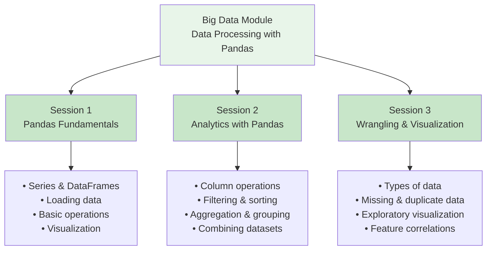
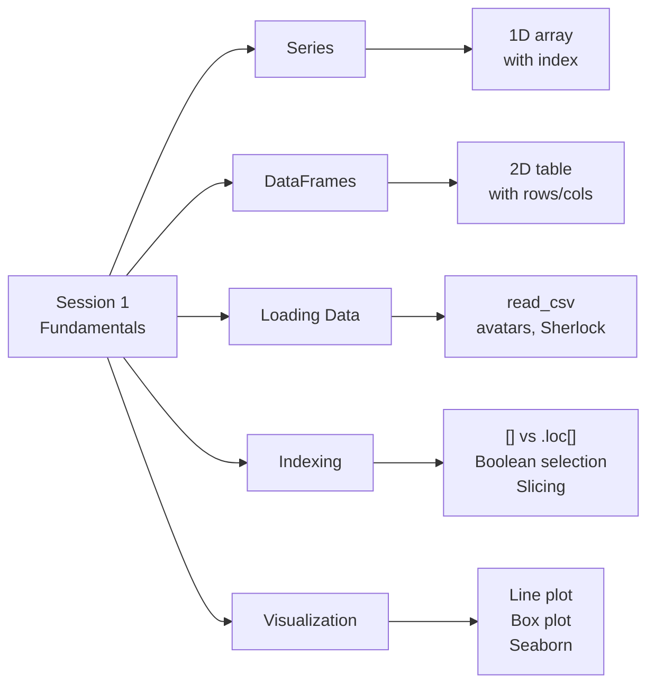
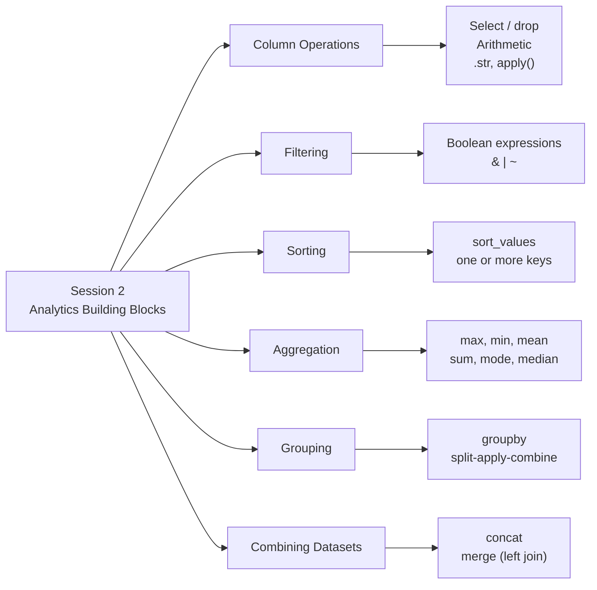
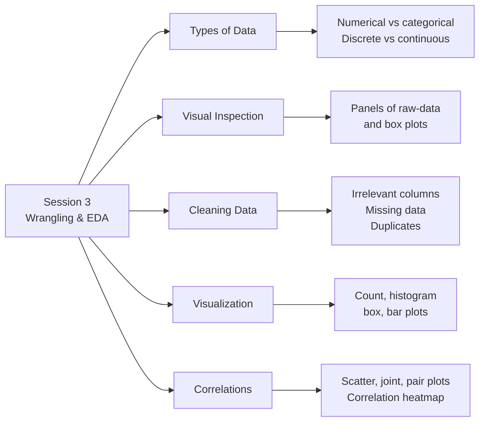
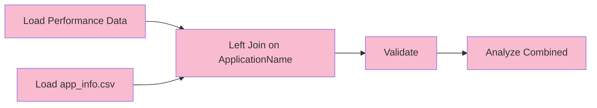
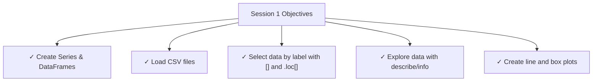
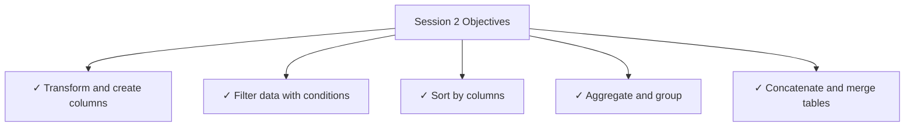
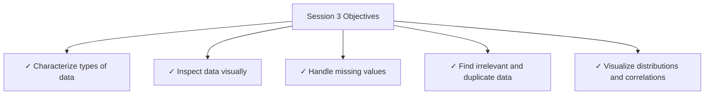

# Big Data Module (module-bd) - Complete Documentation

Welcome to the Big Data module documentation! This guide explains all code and data artifacts in the `module-bd` folder, designed for junior developers and students learning data processing with pandas and Python.

## 📚 Table of Contents

- [Overview](#overview)
- [Folder Structure](#folder-structure)
- [Jupyter Notebooks](#jupyter-notebooks)
- [Datasets](#datasets)
- [Utility Scripts](#utility-scripts)
- [Data Processing Workflows](#data-processing-workflows)
- [Learning Objectives](#learning-objectives)
- [Quick Start Guide](#quick-start-guide)

---

## Overview

The Big Data module teaches practical data processing skills using **pandas**, a powerful Python library for data manipulation and analysis. This module covers:



---

## Folder Structure

```
module-bd/
├── BigData-session-1.ipynb          # Pandas fundamentals
├── BigData-session-2.ipynb          # Analytics with pandas
├── BigData-session-3.ipynb          # Wrangling & visualization
├── avatars.csv                      # Sample dataset (5 records)
├── fig/                             # Visualization images
│   ├── DataFrame.png                # DataFrame structure diagram
│   └── Series.png                   # Series structure diagram
├── sherlock/                        # Mobile app performance data
│   ├── app_info.csv                 # App metadata (53 apps)
│   ├── app_info_missing.csv         # App names without metadata (98)
│   ├── sherlock_head2k.csv          # Performance metrics (2000 records)
│   ├── sherlock_mystery.csv         # Mystery dataset for analysis
│   └── sherlock_mystery_2apps.csv   # 2-apps dataset (788,587 rows, ~76 MB)
├── spam-ip/                         # Source IP + country of spam emails
│   ├── 1999.ip_alg1                 # 1999, algorithm 1 (1,309 emails)
│   ├── 1999.ip_alg2                 # 1999, algorithm 2 (1,309 emails)
│   └── 2003.ip_alg2                 # 2003, algorithm 2 (57,751 emails)
├── statistics/                      # Spam email file sizes
│   ├── Collect-email-sizes.sh       # Shell script to collect sizes (runs on HPC)
│   ├── Statistics-email-sizes.py    # Python statistics calculator
│   ├── email-sizes-1999.txt         # 1999 email sizes (1,309 values)
│   ├── email-sizes-1999-50.txt      # First 50 values of the 1999 file
│   └── email-sizes-2013.txt         # 2013 email sizes (734,190 values)
├── network-intrusion/               # Network intrusion detection
│   └── README.txt                   # Pointer to CIC-IDS-2017 (data not included)
└── .ipynb_checkpoints/              # Jupyter backup files
```

---

## Jupyter Notebooks

### 📓 BigData-session-1.ipynb - Pandas Fundamentals

**Lesson episode:** [Fundamentals of Pandas](https://deapsecure.gitlab.io/deapsecure-lesson02-bd/10-pandas-intro/index.html)  
**Duration:** 45-60 minutes  
**Difficulty:** Beginner  
**Prerequisites:** Python basics

#### Learning Objectives



#### Notebook Sections

1. Setup (Wahab OnDemand Jupyter session, importing libraries)
2. Working with `Series`
3. Working with `DataFrame` (creating, loading Sherlock data, indexing, exercises)
4. Making Sense of Data with Visualization
5. Summary & Further Resources

> **Note:** The notebook imports libraries by their full names
> (`import pandas, numpy, matplotlib, seaborn` and `from matplotlib import pyplot`),
> so the code calls `pandas.Series`, `pandas.read_csv`, `seaborn.boxplot`, and so on.
> The short aliases (`pd`, `np`, `plt`, `sns`) are introduced only in the summary,
> as a common convention.

#### Key Concepts Covered

1. **Series** - 1-dimensional labeled array (values, labels/index, data type)
   ```python
   CPU_USAGE = pandas.Series([0.16, 0.07, 0.23, 0.24, 0.14, 4.99, 0.23, 0.47, 0.46, 0.17])
   len(CPU_USAGE)

   # Irregular index: [] looks up by *label*, not position
   MEM_USAGE = pandas.Series([0.16, 0.07, 0.23, 0.24, 0.14],
                             index=[3, 1, 4, 2, 7])
   MEM_USAGE[3]                      # 0.16 (label 3, not the 4th element)
   MEM_USAGE[[1, 3]]                 # several labels
   MEM_USAGE[[True, False, False, True, True]]   # Boolean selection
   ```

2. **Updating and copying a Series**
   ```python
   MEM_USAGE.loc[7] = 0.33           # update one element
   MEM_USAGE.loc[[1, 3]] = [4, 2]    # update several elements

   COPY_USAGE = MEM_USAGE.copy()     # independent copy
   ALIAS = MEM_USAGE                 # NOT a copy: both names point to the same object
   ```

3. **DataFrames** - 2-dimensional table with row labels and column names
   ```python
   source_table = [['Apple', 50, 155],
                   ['Berry', 46, 154],
                   ['Coco', 56, 156],
                   ['Dunkin', 44, 167],
                   ['Ella', 45, 150]]
   avatars = pandas.DataFrame(source_table, columns=['Name', 'Weight', 'Height'])
   ```

4. **Size and structure of a DataFrame**
   ```python
   len(avatars)          # number of rows
   avatars.shape         # (rows, columns)
   avatars.index         # row labels
   avatars.columns       # column names; avatars.columns[1] -> 'Weight'
   avatars.dtypes        # data type of each column
   type(avatars)         # pandas.core.frame.DataFrame
   ```

5. **Loading data from CSV**
   ```python
   avatars_read = pandas.read_csv("avatars.csv")      # column names come from the header row
   df_mystery = pandas.read_csv("sherlock/sherlock_mystery.csv")
   ```

6. **Initial exploration**
   ```python
   df_mystery.head(10)      # first rows (default 5)
   df_mystery.tail(10)      # last rows
   df_mystery.describe()    # stats for numeric columns only
   df_mystery.describe().T  # transposed, easier to read
   df_mystery.info()        # index, non-null counts, dtypes
   ```

7. **Accessing elements in a DataFrame**
   ```python
   df6 = df_mystery.head(6).copy()

   df6['ApplicationName']                          # one column -> Series
   df6[['ApplicationName', 'CPU_USAGE', 'num_threads']]  # list of columns -> DataFrame
   df6[[True, False, False, True, True, False]]   # Boolean list -> selects ROWS

   df6.loc[1]                                      # one row by label -> Series
   df6.loc[[1, 3, 5]]                              # several rows -> DataFrame
   df6.loc[1, 'num_threads']                       # single cell
   df6.loc[[1, 2, 5], ['num_threads', 'CPU_USAGE']]  # rows x columns
   df6.loc[2, 'CPU_USAGE'] = 0.01                  # update with .loc

   # Slicing with .loc includes BOTH endpoints
   df6.loc[1, :]
   df6.loc[:, 'CPU_USAGE']
   df6.loc[:3]
   df6.loc[:3, 'CPU_USAGE':'num_threads']
   ```
   On a DataFrame, `[]` selects columns (or rows when you pass Booleans).
   Use `.loc[]` to select rows by label and to write values.

8. **Visualization**
   ```python
   df_mystery['vsize'].plot(kind='line')       # raw values against row label
   df_mystery['vsize'].plot(kind='box')        # box-and-whisker plot
   seaborn.boxplot(x=df_mystery['vsize'], color='cyan')
   ```

#### Datasets Used

- **avatars.csv** - 5 records (Name, Weight, Height)
  - Same data as the `avatars` DataFrame built from a nested list
  - Purpose: Learning how `read_csv` infers column names and types
- **sherlock/sherlock_mystery.csv** - 200 records × 14 columns (Facebook and WhatsApp)
  - Purpose: Exploration, indexing, and plotting practice
- **fig/Series.png**, **fig/DataFrame.png** - Diagrams of the two data structures

#### Exercises

- Update the element with label `1` to `1.10`, then update `MEM_USAGE` with `.loc[]` and Boolean-array selection
- Compare `.copy()` with plain assignment
- Explore `df_mystery` (`shape`, `columns`, `dtypes`, `describe`, `info`)
- Quiz: mean of `num_threads` (answer: `71.365`)
- Exercise 1: compare `df['CPU_USAGE']` with `df[['CPU_USAGE']]`, and `df.loc[1]` with `df.loc[[1]]`
- Exercise 2: rows labeled 5-15, columns `ApplicationName` through `priority`
- Exercise 3: build a DataFrame without the `Unnamed: 0` column
- Exercise 4: set every `cminflt` value in `df6` to `0`
- Plot `vsize` and `CPU_USAGE`, then compare the plots with `describe()`

#### Notebook Updates

These fixes have been made to the original notebook:
- **Section 2.3, Boolean-array update exercise:** the answer cell now uses Boolean indexing and gives the
  target result. It used to set labels 2 and 4 to 0.55 and 0.66. The last row of the "After update" table is
  now correctly labeled `7` (it was `3`).
  ```python
  # Before: 3→2.00, 1→4.00, 4→0.23, 2→0.24, 7→0.33
  MEM_USAGE.loc[[True, False, False, True, True]] = [1.0, 2.0, 3.0]
  # After:  3→1.00, 1→4.00, 4→0.23, 2→2.00, 7→3.00
  ```
- **Section 3.3.5, Boolean row selector:** the instructions now give a 6-value selector
  (`[False,True,True,False,True,False]`), one value per row of `df6`. The old 5-value selector raised
  `IndexError: Boolean index has wrong length: 5 instead of 6` in current pandas.
  This also answers the follow-up question about a selector shorter than the DataFrame: pandas raises
  that `IndexError` instead of ignoring the remaining rows.
- **Numbering:** "Accessing a Subset of a Series" is now 2.2.2 (it duplicated 2.2.1).
- **Headings:** "2.1 Creating a `Series` Object" is now the same heading level as 2.2–2.4.
- **Section 1.2, setup:** the import cell no longer says "Uncomment, edit" or ends with a leftover
  `# import #TODO`; the imports were already complete. The note below it now points to the existing
  `!pip install seaborn` cell, instead of telling learners to create one.
- **Section 2.3:** added an answer cell, with a placeholder, for "Update the element with label `1` to `1.10`".
  It was the only exercise without one.
- **Demo cells:** four walkthrough cells no longer say "Uncomment"; their code was already uncommented.
  They are the copy demo (2.4), creating `avatars` from a nested list (3.1.1), the Boolean row filter (3.3.3),
  and selecting a single cell with `.loc[]` (3.3.5).
- **Heading format:** "4 Making Sense of Data with Visualization" now has the same "4." numbering style as the other
  sections, and "4.2 Box-and-Whisker Plot" lost a trailing space.
- **Section 2.4, link:** the Real Python hint now links to the section "Variables Hold References to Objects".
  The old `#variable-assignment` section no longer exists after the article was rewritten.
- **Section 5, summary:** corrected the indexing note. It claimed `.loc[]` is "the only way" to select rows
  and that `[]` only selects columns, which contradicted Section 3.3.3 (`[]` with a Boolean array selects rows).
  It now says `[]` with column names selects columns, and `.loc[]` selects rows by label.

#### Library Version Notes

The notebook was written for Python 3.7 and runs without errors or warnings on current pandas and seaborn.
One difference you will notice: the notebook says text columns have the `object` data type.
In pandas 3, `dtypes` and `info()` show them as `str` instead (e.g. `Name` in `avatars.csv`).

---

### 📓 BigData-session-2.ipynb - Analytics of Sherlock Data with Pandas

**Lesson episode:** [Analytics of Sherlock Data with Pandas](https://deapsecure.gitlab.io/deapsecure-lesson02-bd/20-analytics-intro/index.html)  
**Duration:** 45-60 minutes  
**Difficulty:** Intermediate  
**Prerequisites:** Session 1 completion

#### Learning Objectives



#### Notebook Sections

1. Setup (libraries, loading `sherlock_mystery.csv`, feature descriptions)
2. Column Operations (selection, dropping, arithmetic, string operations, custom transformations)
3. Filtering
4. Sorting
5. Aggregation
6. Grouping
7. Combining Multiple Datasets (concatenation, SQL-like join)
8. Key Points

> **Note:** Most code cells in this notebook are still `#TODO` placeholders for
> learners to complete. Keep a backup of the data so you can reset it after mistakes:
> `df_backup = df_mystery.copy()`, then `df_mystery = df_backup.copy()`.

#### Key Concepts Covered

1. **Column selection and removal**
   ```python
   df_memstats = df_mystery[['ApplicationName', 'vsize', 'Mem', 'otherPrivateDirty']]

   df_mystery2 = df_mystery.drop('Unnamed: 0', axis=1)            # drop a column
   df_features_only = df_mystery.drop(['Unnamed: 0', 'ApplicationName'], axis=1)
   df_mystery.drop('Unnamed: 0', axis=1, inplace=True)            # change the original
   df_mystery3 = df_mystery.drop(range(10), axis=0)               # drop rows labeled 0-9
   ```

2. **Arithmetic and new columns** (element-wise, matched by index)
   ```python
   df_mystery['vsize_gb'] = df_mystery['vsize'] * 1e-9            # bytes -> GB
   df_mystery['utime_self'] = df_mystery['utime'] - df_mystery['guest_time']
   ```

3. **String operations** with the `.str` accessor
   ```python
   df_mystery['ApplicationName'] = df_mystery['ApplicationName'].str.upper()
   ```

4. **Custom transformations** with `apply()`
   ```python
   def to_giga(val):
       return val * 1e-9
   df_mystery['vsize_gb2'] = df_mystery['vsize'].apply(to_giga)

   def non_negative(val):
       return val if val > 0 else 0
   df_mystery['guest_time_fix'] = df_mystery['guest_time'].apply(non_negative)
   ```
   `apply()` calls the function once per element. It is much slower than
   pandas' built-in vectorized operations, so use built-ins when one exists.

5. **Filtering** with Boolean expressions
   ```python
   df_mystery[df_mystery['CPU_USAGE'] > 2]
   df_mystery[(df_mystery['ApplicationName'] == 'Facebook') & (df_mystery['CPU_USAGE'] > 0.5)]
   df_mystery[(df_mystery['ApplicationName'] == 'Facebook') | (df_mystery['CPU_USAGE'] > 0.5)]
   ```
   Wrap each comparison in parentheses when combining with `&` (AND), `|` (OR), or `~` (NOT).
   Other Boolean helpers: `isna()`, `notna()`.

6. **Sorting**
   ```python
   df = df_backup[['ApplicationName', 'CPU_USAGE', 'num_threads',
                   'vsize', 'utime', 'cutime']].copy()

   df.sort_values(by='CPU_USAGE', ascending=False)                    # CPU hogs
   df.sort_values(by=['num_threads', 'CPU_USAGE'], ascending=False)   # two keys
   df.sort_values(by=['num_threads', 'utime'], ascending=[False, True])
   df[df['CPU_USAGE'] == 0].sort_values(by='num_threads', ascending=False)  # filter + sort
   df[df['CPU_USAGE'] != 0].sort_values(by=['CPU_USAGE', 'num_threads'],
                                        ascending=[True, False])          # mixed directions
   ```

7. **Aggregation** over the whole table or one column
   ```python
   df_mystery.max()
   df_mystery['lru'].mean()
   df_mystery['ApplicationName'].mode()
   df_mystery['cutime'].median()
   df_mystery['cutime'].sum()
   df_mystery.max(axis=1, numeric_only=True)    # per row
   df_mystery.mean(numeric_only=True)           # mean of every numeric column
   ```
   `df_mystery.mean()` and `df_mystery.median()` fail in current pandas because of the text
   column `ApplicationName`, so add `numeric_only=True`. `max()`, `min()`, `sum()` and `mode()`
   still work on text.

8. **Grouping** (split-apply-combine)
   ```python
   df.groupby('ApplicationName')['vsize'].max()
   df.groupby('ApplicationName').max()
   df.groupby('ApplicationName')['utime'].sum()   # total CPU time per app
   df.groupby('ApplicationName').size()           # records per app
   df.groupby('ApplicationName').describe().T
   ```

9. **Combining datasets**
   ```python
   # Concatenate (stack rows). Columns are aligned by name; missing ones become NaN.
   columns_both = ['ApplicationName', 'CPU_USAGE', 'utime', 'cutime',
                   'vsize', 'num_threads']
   df_set1 = pandas.read_csv("sherlock/sherlock_mystery.csv", usecols=columns_both)
   df_set2 = pandas.read_csv("sherlock/sherlock_head2k.csv", usecols=columns_both)
   df_combined = pandas.concat([df_set1, df_set2])          # 2200 rows x 6 columns

   # Left outer join: add Vendor and ApplicationType to every row
   df_appinfo = pandas.read_csv('sherlock/app_info.csv')
   df_master = df_combined.merge(right=df_appinfo, how='left', on='ApplicationName')
   ```
   If you concatenate the two full files without `usecols`, you get 2200 rows × 61 columns,
   and many cells are `NaN` because each file has columns the other lacks.
   Older pandas (before 1.0) warned about this with `Sorting because non-concatenation axis is
   not aligned`. Current pandas gives no warning, so always check the result with `info()`.
   After the left join, rows whose app is not in `app_info.csv` (129 of the 2200,
   including the Facebook and WhatsApp rows) have `NaN` for `Vendor` and `ApplicationType`.

#### Datasets Used

- **sherlock/sherlock_mystery.csv** - 200 records × 14 columns (Facebook and WhatsApp)
  - Main dataset for column operations, filtering, sorting, aggregation, and grouping
- **sherlock/sherlock_head2k.csv** - 2000 records × 58 columns (39 different apps)
  - Concatenated with `sherlock_mystery.csv` in Section 7.1
- **sherlock/app_info.csv** - 53 records (ApplicationName, Vendor, ApplicationType)
  - Right-hand table for the left join in Section 7.2

#### Exercises

- Build `df_memstats` (and optionally a CPU-stats DataFrame)
- Drop `Unnamed: 0`, non-feature columns, and rows labeled 0-9
- Convert `vsize` to GB; compute `utime_self` (bonus: print it next to `utime` and `guest_time`)
- Upper-case `ApplicationName`
- Replace the 32 negative `guest_time` values with zero using `apply()`
- Challenge: fix Lee's `value_range` function. It fails on the text column `ApplicationName`;
  one fix uses `describe()` and computes `max - min`.
- Filter Facebook records with `CPU_USAGE > 0.5` (7 rows with AND, 126 rows with OR)
- Find CPU, memory, and thread "hogs" by sorting
- Aggregate per application with `groupby`
- Concatenate `sherlock_mystery.csv` and `sherlock_head2k.csv`, then left-join `app_info.csv`

#### Notebook Updates

These fixes have been made to the original notebook:
- **Section 1.4, features table:** added the missing `ApplicationName` row, so the table now lists all
  14 columns. `cutime`, `utime`, `cminflt`, `guest_time` and `queue` are now listed as `float`, not `int`.
- **Numbering:** "Custom Transformations" is now 2.5 (it duplicated 2.4).
- **Section 4, Example 5:** the placeholder used to hard-code `ascending=False`, which sorts both keys
  descending. It is now `ascending=[#TODO]`, with a hint to pass lists to both `by=` and `ascending=`.
- **Section 5, aggregation experiments:** the list now uses `df_mystery`, matching the code cell. It used
  `df`, the sorting subset, which has no `lru` column.
- **Section 7.1:** the comment above `columns_both` no longer claims the list comes from a set operation.
  It is a hand-picked list of six columns; the two files share 11.
- **Answer cells added** (with `#TODO` placeholders) for three exercises that had nowhere to write the answer:
  the optional CPU-features DataFrame (2.1), the bonus question printing `utime_self`, `utime` and
  `guest_time` side by side (2.3), and the second half of the `value_range` challenge, computing the range
  from `describe()` (2.5).
- **Broken links:** two links pointed to pandas' "Computational Tools" page, which pandas has removed (404).
  Both now point to the [descriptive statistics](https://pandas.pydata.org/docs/user_guide/basics.html#descriptive-statistics)
  section of the user guide: the performance note in 2.5 and the list of aggregation methods in Section 5.

#### Library Version Notes

The notebook was written for Python 3.7 and has been updated for current pandas:
- The aggregation section notes that `mean()` and `median()` need `numeric_only=True` on a
  DataFrame with text columns. Older pandas skipped text columns silently.
- The concatenation section no longer expects the `Sorting because non-concatenation axis is not aligned`
  warning, which pandas 1.0 removed.

All code cells run without errors or warnings on current pandas once the `#TODO` placeholders are filled in.

---

### 📓 BigData-session-3.ipynb - Data Wrangling and Visualization

**Lesson episode:** [Data Wrangling and Visualization](https://deapsecure.gitlab.io/deapsecure-lesson02-bd/30-data-wrangling-viz/index.html)  
**Duration:** 45-60 minutes  
**Difficulty:** Intermediate-Advanced  
**Prerequisites:** Sessions 1-2 completion

#### Learning Objectives



#### Notebook Sections

1. Setup (libraries, optional `figsize` settings)
2. Loading the "2-apps" dataset and comparing it with `sherlock_mystery.csv`
3. Data Preparation (common data issues; finding missing data with `info()`)
4. Data Wrangling (types of data, visual data inspection)
5. Cleaning Data (irrelevant, missing, and duplicate data)
6. Visualization (count plot, histogram, box plot, bar plot)
7. Correlations Among Features (scatter, joint, pair plots, heatmap)
8. Conclusion (record the data issues and patterns you found)

The notebook guides you through four exploration questions:
1. What are the statistical properties (mean, spread, distribution) of each feature?
2. Which issues need cleaning (useless features, missing data, duplicates, outliers)?
3. Which app uses more CPU and more memory on average?
4. Which features are correlated?

#### Key Concepts Covered

1. **Loading a larger dataset and comparing it with a small one**
   ```python
   df2 = pandas.read_csv("sherlock/sherlock_mystery_2apps.csv")   # ~76 MB, 788,587 rows
   df2_backup = df2.copy()
   df2.describe().T
   pandas.read_csv("sherlock/sherlock_mystery.csv").describe().T  # compare statistics
   ```

2. **Types of data**: numerical vs categorical, discrete vs continuous, qualitative vs quantitative.
   For example, `ApplicationName` is categorical. `priority` holds only four integer values
   (9, 14, 16, 20), so it behaves like ordinal data.

3. **Visual inspection with a panel of plots** (one subplot per numeric column)
   ```python
   fig = pyplot.figure(figsize=(16.0, 10.0))
   columns = (c for c in df2.columns if c != "ApplicationName")
   for i, col in enumerate(columns):
       axes = fig.add_subplot(5, 3, i+1)
       axes.set_ylabel(col)
       df2[col].plot(ax=axes)                  # or: seaborn.boxplot(x=df2[col], ax=axes)
   ```

4. **Irrelevant column**: prove that `Unnamed: 0` only repeats the row labels, then drop it
   ```python
   print(df2['Unnamed: 0'].head().tolist(), df2.index[:5].tolist())   # spot-check
   same = (df2['Unnamed: 0'] == df2.index)    # a Series can be compared with an Index
   print(same.sum(), "of", len(df2))          # 788587 of 788587
   print(same.all())                          # True

   df2 = df2.drop(columns=['Unnamed: 0'])     # not 'queue': it is a real feature
   ```

5. **Missing data** (practice on the toy DataFrame `ex0` first)
   ```python
   ex0.isna()               # True where a value is missing (notnull() is the opposite)
   ex0.isna().sum()         # missing count per column (axis=0)
   ex0.isna().sum(axis=1)   # missing count per row
   ex0.dropna()             # drop rows with ANY missing value
   ex0.dropna(how='all')    # drop rows where ALL values are missing
   ex0.dropna(axis=1)       # drop columns with missing values
   ex0.fillna(7)            # fill with a constant
   ex0.fillna(ex0.mean(skipna=True))   # fill with the column mean (imputation)

   df2.isna().sum()                    # cminflt: 176,473 missing (22.4%)
   df2.dropna(inplace=True)            # course of action: drop those rows -> 612,114 rows left
   ```

6. **Duplicate rows and columns**
   ```python
   df3.duplicated()                    # True for each row that repeats an earlier row
   df3.index[df3.duplicated()]         # labels of duplicate rows
   df3.drop_duplicates(inplace=True)   # synthetic df3 (built after dropna): 20 rows -> 17 rows

   (df2['Mem'] == df2['vsize']).all()  # True: Mem is an exact duplicate of vsize
   ```
   `guest_time` and `utime` look identical in plots and have a correlation of 1.0, but they
   are not equal: `guest_time` is roughly `utime` × 0.048. Check whether a column is really a
   duplicate before you drop it.

7. **Visualization**
   ```python
   seaborn.countplot(x='ApplicationName', data=df2)    # records per app
   df2.groupby('ApplicationName').size()                # cross-check the count plot

   pyplot.hist(df2['CPU_USAGE'], bins=20)               # returns (counts, bin_edges, patches)
   seaborn.histplot(df2['CPU_USAGE'], bins=20)          # seaborn < 0.11: distplot(..., kde=False)

   nthrds_FB = df2[df2['ApplicationName'] == 'Facebook']['num_threads']
   nthrds_WA = df2[df2['ApplicationName'] == 'WhatsApp']['num_threads']
   rng = (df2['num_threads'].min(), df2['num_threads'].max())
   pyplot.hist(nthrds_FB, label='Facebook', bins=20, range=rng)
   pyplot.hist(nthrds_WA, label='WhatsApp', bins=20, range=rng)
   pyplot.legend()

   seaborn.boxplot(x=df2['guest_time'][:2000])
   seaborn.barplot(x='ApplicationName', y='CPU_USAGE', data=df2)   # mean with error bar
   seaborn.barplot(x='ApplicationName', y='CPU_USAGE', data=df2, errorbar='sd')  # standard deviation
   ```

8. **Correlations among features**
   ```python
   seaborn.scatterplot(x='utime', y='vsize', data=df2)
   seaborn.scatterplot(x='Mem', y='vsize', data=df2)
   seaborn.jointplot(x='utime', y='vsize', data=df2)   # scatter plot + histograms on both axes
   seaborn.pairplot(df2[['CPU_USAGE', 'num_threads', 'otherPrivateDirty', 'priority', 'vsize']])

   df_corr = df2.corr(numeric_only=True)               # Pearson correlation
   pyplot.figure(figsize=(12, 12))
   seaborn.heatmap(df_corr, annot=True, vmax=1, square=True, cmap="Blues")
   ```

#### Expected Findings

These figures come from the full `sherlock_mystery_2apps.csv` after dropping
`Unnamed: 0` and the rows with missing `cminflt`.

| Question | Finding |
|---|---|
| Irrelevant column | `Unnamed: 0` (its values equal the row labels) |
| Missing data | `cminflt`: 176,473 of 788,587 values (22.4%) |
| Duplicate columns | `Mem` = `vsize` exactly; `guest_time` is roughly proportional to `utime` |
| Records per app | Facebook 481,760; WhatsApp 306,827 (before cleaning) |
| Higher average CPU | WhatsApp (0.367 vs 0.293) |
| Higher average memory (`vsize`) | Facebook (2.23 GB vs 2.07 GB) |
| Strong correlations | `vsize`–`Mem` (1.00), `utime`–`guest_time` (1.00), `priority`–`queue` (−1.00), `num_threads`–`vsize` (0.86) |
| Moderate correlations | `otherPrivateDirty`–`utime` (0.63), `cutime`–`cminflt` (0.59) |

> **Why not `queue`?** `queue` looks suspicious, but it doesn't match the row labels. It is a
> real feature computed from `priority` (correlation −1.00), so Section 5.1 drops `Unnamed: 0` instead.
> (An earlier version of the notebook dropped `queue` by mistake.)

> **Histogram tip:** `CPU_USAGE` ranges from 0 to about 115, but over 99% of values fall in the
> first of 20 bins, so most bars are too small to see. Look at `hist_plot[0]` for the counts.

#### Datasets Used

- **sherlock/sherlock_mystery_2apps.csv** - 788,587 records × 14 columns (Facebook and WhatsApp), ~76 MB
  - Main dataset ("2-apps") for cleaning, visualization, and correlation
- **sherlock/sherlock_mystery.csv** - 200 records × 14 columns
  - For comparing statistics with the larger dataset

#### Exercises

- Explore `df2` and compare its `describe()` output with `sherlock_mystery.csv`
- Classify features as categorical, quantitative, or continuous
- Diagnose strange or duplicate features from the line-plot and box-plot panels
- Optional: prove that the irrelevant column equals the row labels (`Series == Index`), then drop it
- Practice `isna`, `dropna`, and `fillna` on `ex0`; count missing values in `df2` and their fraction
- Discuss pros and cons of dropping rows, dropping the column, or imputing
- Find and remove duplicate rows in the synthetic `df3`. After dropping `Unnamed: 0` and the rows with missing values, 3 rows are flagged: the repeated 6th row and the first two of the re-labeled extras (labels 181000, 181001). If you skip the `dropna` step, rows 2 and 3 are also flagged. They are real snapshots whose values happen to match rows 0 and 1, an example of the notebook's advice to check duplicates before removing them.
- Challenge: decide whether `guest_time`/`utime` and `vsize`/`Mem` are genuine duplicates
- Plot a count plot, histograms of `CPU_USAGE`, `priority`, and `num_threads` (with separate histograms per app), a box plot of the first 2000 `guest_time` values, and a bar plot
- Create scatter plots (`utime`/`vsize`, `Mem`/`vsize`), a joint plot (`utime`/`vsize`), a pair plot of
  five named columns, and a correlation heatmap
- Write up conclusions: missing, irrelevant, and duplicate data, plus observed patterns

#### Notebook Updates

These fixes have been made to the original notebook:
- **Section 5.1, irrelevant column:** the answer cell now drops `Unnamed: 0`. It used to drop `queue` by mistake.
- **Section 5.1, optional proof:** the cell now proves that `Unnamed: 0` equals the row labels for every row
  (with its output saved), instead of just showing `head()` and `tail()`.
- **Section 7.1, joint plot syntax:** fixed a typo. It's now `jointplot(x=COLUMN_NAME_1, y=COLUMN_NAME_2, ...)`;
  before, both axes used `COLUMN_NAME_2`.
- **Section 4.2, outliers:** corrected the definition. Box-plot dots are values beyond 1.5 × IQR from the
  quartiles (as Section 6.3 says), not values outside the 2%–98% percentiles. For normally distributed
  data, that rule flags about 0.7% of values (below the 0.35th or above the 99.65th percentile).
- **Section 6.3, box plot exercise:** the code cell now says "first 2000 records", matching the instructions.
  It used to say "all records".
- **Section 7.1, scatter plot questions:** the first question was cut off mid-sentence. It is now complete,
  plus a follow-up question about the `vsize` vs `Mem` plot.
- **Section 7.1, joint plot exercise:** the code cell now asks for `vsize` against `utime`, matching the
  instructions. It used to say `Mem`.
- **Answer cells added** (with `#TODO` placeholders) for exercises that had nowhere to write the answer:
  the duplicate-columns challenge (5.3), the questions and optional exercises about `hist_plot` (6.2), and
  the questions about the `priority` histogram's `Res` (6.2).
- **Section 5.1:** the cell that shows `df2.head(20)` no longer says "Uncomment"; nothing in it is commented out.
- **Headings:** "2.1. Initial Exploration" lost its stray trailing period, and "6.3  Box Plot" its double space.
- **Section 7.2, pair plot:** the instructions now select five columns by name, matching the answer cell.
  They used `df2.iloc[:,5:9]`, which picks columns by position, so the result changed depending on which
  columns earlier cells had dropped.

#### Library Version Notes

The notebook was written for Python 3.7 and has been updated for current seaborn and pandas:
- Histograms use `seaborn.histplot` (seaborn 0.11+). On older seaborn, use `seaborn.distplot(..., kde=False)`.
- Bar plots show the standard deviation with `errorbar='sd'` (seaborn 0.12+). On older seaborn, use `ci='sd'`.
- Box plots pass the data as `seaborn.boxplot(x=df2[COLUMN])`.
- The correlation heatmap uses `df2.corr(numeric_only=True)`, because plain `corr()` fails on the text
  column `ApplicationName` in current pandas. On pandas before 1.5, use plain `corr()`: those versions
  skip text columns automatically and don't accept the argument.

With seaborn 0.13.2 and matplotlib 3.11, every box plot shows a `MatplotlibDeprecationWarning` about `vert`.
It comes from inside seaborn, not the notebook code, and the plots are still correct.

---

## Datasets

### 1. avatars.csv

**Purpose:** Simple introductory dataset  
**Size:** 5 records  
**Format:** CSV

**Structure:**
```
Name,Weight,Height
Apple,50,155
Berry,46,154
Coco,56,156
Dunkin,44,167
Ella,45,150
```

**Use Cases:**
- Session 1: comparing a DataFrame loaded with `read_csv` against one built from a nested list
- Understanding how CSV headers become column names

---

### 2. sherlock/ - Mobile App Performance Data

**Purpose:** Real-world mobile app performance metrics  
**Source:** Sherlock dataset from mobile device monitoring

#### app_info.csv

**Size:** 53 records (10 vendors, 20 application types)  
**Columns:** ApplicationName, Vendor, ApplicationType

**Sample:**
```
ApplicationName,Vendor,ApplicationType
Google App,Google,Search
Google Play services,Google,Services
System UI,Google,User Experience
Phone,Google,Phone
```

**Use Cases:**
- Session 2: right-hand table in the left join (`merge(how='left', on='ApplicationName')`)
- Vendor and application-type analysis

**Note:** Facebook and WhatsApp are not listed, so their rows get `NaN` after the join.

#### app_info_missing.csv

**Size:** 98 lines, one application name per line, no header row  
**Content:** Names of apps (e.g. `PopupuiReceiver`, `Mobile tracker`) that have **no** entry in `app_info.csv`. Despite the name, it is not a copy of `app_info.csv` with gaps. It has no Vendor or ApplicationType columns.

**Note:** No notebook uses this file. Read it with `header=None`, or pandas will treat the first app name as the column header:
```python
missing_apps = pd.read_csv('sherlock/app_info_missing.csv', header=None, names=['ApplicationName'])
```

**Use Cases:**
- A list of apps whose metadata still needs to be filled in to complete `app_info.csv`

#### sherlock_head2k.csv

**Size:** 2000 records × 58 columns (39 different apps; the most frequent is Google App)

**Key Columns:**
- Identifiers: `UserId`, `UUID`, `ApplicationName`, `PackageName`, `PackageUID`
- CPU: `CPU_USAGE`, `utime`, `stime`, `cutime`, `guest_time`
- Memory: `vsize`, `rss`, `dalvikPss`, `nativePss`, `otherPss`, `*PrivateDirty`, `*SharedDirty`
- Network: `UidRxBytes`, `UidRxPackets`, `UidTxBytes`, `UidTxPackets`
- Process: `pid`, `ppid`, `pgid`, `priority`, `num_threads`, `state`, `importance`

**Notes:**
- 13 columns are completely empty (`tgpid`, `flags`, `wchan`, `exit_signal`, `minflt`, `cminflt`, `majflt`, `startcode`, `endcode`, `nice`, `itrealvalue`, `processor`, `rt_priority`)
- Of the 14 columns in `sherlock_mystery.csv`, 11 also appear here. The 3 missing ones are `Unnamed: 0`, `Mem`, and `queue`. Session 2's concatenation exercise keeps only six of the shared columns.

**Sample (first row):**
```
UserId: 97bb95f55a
ApplicationName: Gmail
CPU_USAGE: 0.13
num_threads: 32
vsize: 2064265216
UidRxBytes: 0
UidTxBytes: 0
```

**Use Cases:**
- Session 2: concatenating with `sherlock_mystery.csv`
- Grouping and aggregation across many apps

#### sherlock_mystery.csv

**Size:** 200 records × 14 columns (121 Facebook, 79 WhatsApp)  
**Purpose:** Tiny extract of Sherlock's `Applications` data, used in Sessions 1 and 2

**Columns:** `Unnamed: 0` (original record index), `ApplicationName`, `CPU_USAGE`, `cutime`, `lru`, `num_threads`, `otherPrivateDirty`, `priority`, `utime`, `vsize`, `cminflt`, `guest_time`, `Mem`, `queue`

**Notes:**
- `cminflt` has 48 missing values (`NaN`)
- `Unnamed: 0` is not a real feature (Session 1, Exercise 3 removes it)

**Use Cases:**
- Session 1: initial exploration, indexing, and plotting
- Session 2: column operations, filtering, sorting, and grouping

#### sherlock_mystery_2apps.csv

**Size:** 788,587 records × 14 columns, ~76 MB on disk (~95 MB in memory)  
**Apps:** Facebook (481,760 rows), WhatsApp (306,827 rows)  
**Columns:** Same 14 as `sherlock_mystery.csv`

**Data quality issues (found in Session 3):**
- `Unnamed: 0` equals the row index, so it is irrelevant
- `cminflt` has 176,473 missing values (22.4%)
- `Mem` is an exact duplicate of `vsize`
- `guest_time` is roughly proportional to `utime`, and 130,118 of its values are slightly negative
- `queue` is computed from `priority` (correlation −1.00)

**Use Cases:**
- Session 3: data cleaning, exploratory visualization, and correlation analysis

---

### 3. spam-ip/ - Spam Email IP Analysis

**Purpose:** The source IP address and country of each spam email, extracted from the email headers  
**Time Period:** 1999 and 2003  
**Source:** Most likely the same spam archive that `Collect-email-sizes.sh` reads on the HPC cluster (`.../spams/untroubled/YEAR/`), because the email paths have the same `YEAR/MONTH/file` layout  
**Used in notebooks:** None (available for extra practice)

#### File Format

Pipe-delimited (`|`), no header row, always 4 fields per line:

```
EMAIL_PATH|SOURCE_IP|COUNTRY_CODE|COUNTRY_NAME
```

```
1999/01/915202605.14113.txt|198.81.17.10|US|United States
1999/01/915202639.14137.txt|193.68.153.2|BG|Bulgaria
2003/01/1041437872.5269_13.txt|10.0.0.1|-|-
1999/01/915202605.14113.txt||Fail to get source IP|
```

**Fields:**
- `EMAIL_PATH`: `YEAR/MONTH/<file name>` of the email in the archive
- `SOURCE_IP`: the extracted IP address; **empty** when extraction failed
- `COUNTRY_CODE`: two-letter country code. When extraction failed, this field holds the **error message** instead.
- `COUNTRY_NAME`: full country name; empty on failure

**Special values:**
- `-|-` for country: the IP has no country, e.g. private or loopback addresses such as `10.0.0.1` and `127.0.0.1`
- Error messages: `Fail to get source IP`, `Malformed IP address`, `Malformed email header or missing Received: fields`

**Loading with pandas:**
```python
cols = ['path', 'ip', 'country_code', 'country']
ips = pd.read_csv('spam-ip/1999.ip_alg2', sep='|', header=None, names=cols, dtype=str)
failed = ips['ip'].isna()            # rows where extraction failed
ips[~failed]['country'].value_counts().head()
```

#### Files

| File | Records | Year | Algorithm | IP found | Failed | Countries | Top countries |
|------|---------|------|-----------|----------|--------|-----------|---------------|
| 1999.ip_alg1 | 1,309 | 1999 | Algorithm 1 | 422 (32%) | 887 | 32 | US 256, China 37 |
| 1999.ip_alg2 | 1,309 | 1999 | Algorithm 2 | 1,271 (97%) | 38 | 57 | US 700, China 98, South Korea 65 |
| 2003.ip_alg2 | 57,751 | 2003 | Algorithm 2 | 57,437 (99.5%) | 314 | 165 | US 19,752, China 6,585, France 4,058 |

The two 1999 files cover the same 1,309 emails, so you can compare the algorithms directly.
Algorithm 2 extracts an IP far more often. The "Countries" count includes `-` (no country).

**Use Cases:**
- Parsing delimited text files with `read_csv(sep='|')`
- Handling failed extractions (empty fields, error messages in the wrong column)
- Comparing algorithms on the same emails
- Grouping by country, or by month (from the path), to see how spam sources changed from 1999 to 2003

---

### 4. statistics/ - Email Size Statistics

**Purpose:** File sizes of spam emails, for practicing descriptive statistics  
**Time Period:** 1999 and 2013  
**Used in notebooks:** None. These files go with `Statistics-email-sizes.py` (see [Utility Scripts](#utility-scripts)).

#### email-sizes-YYYY.txt

**Format:** One integer per line (email file size in bytes), no header

**Sample** (first lines of `email-sizes-1999.txt`):
```
2304
2175
3318
4083
1677
```

**Files:**

| File | Emails | Total (bytes) | Mean | Median | Min | Max |
|------|--------|---------------|------|--------|-----|-----|
| email-sizes-1999.txt | 1,309 | 5,955,950 | 4,550.0 | 2,792 | 709 | 61,002 |
| email-sizes-1999-50.txt | 50 | 152,518 | 3,050.4 | — | 1,015 | 11,018 |
| email-sizes-2013.txt | 734,190 | 2,647,377,963 | 3,605.8 | 2,583 | 406 | 862,254 |

`email-sizes-1999-50.txt` holds the first 50 values of the 1999 file. It's a small sample for quick tests.
Both full files are strongly right-skewed: the mean is well above the median because of a few very large emails.

**Loading with pandas:**
```python
sizes = pd.read_csv('statistics/email-sizes-2013.txt', header=None, names=['bytes'])
sizes['bytes'].describe()
```

**Use Cases:**
- Descriptive statistics (count, sum, mean, median, min, max)
- Comparing the distributions of 1999 and 2013
- Cross-checking results from other tools (e.g. Spark)

---

## Utility Scripts

### 1. Collect-email-sizes.sh

**Purpose:** Shell script that produced the `email-sizes-YYYY.txt` files from the spam archive on HPC storage. It has to run on the cluster (the script header says *Turing*), because the archive path doesn't exist locally.

**Location:** `statistics/Collect-email-sizes.sh`

**Usage:** (YEAR is a 4-digit year, 1998–2018)
```bash
./Collect-email-sizes.sh 1999 > email-sizes-1999.txt
```

**What it does:**
```bash
#!/bin/bash
YEAR=$1
find /scratch-lustre/DeapSECURE/module01/spams/untroubled/"$YEAR"/[0-9][0-9] -type f \
    | xargs ls -l \
    | awk '{print $5}'
```

**Steps:**
1. Takes year as argument
2. Finds all email files in that year
3. Gets file sizes using `ls -l`
4. Extracts size column (5th field) using `awk`

**Output:** One file size per line (in bytes)

**Use Cases:**
- Data collection from HPC systems
- Batch processing
- Shell scripting practice

---

### 2. Statistics-email-sizes.py

**Purpose:** Print basic statistics for an `email-sizes-YYYY.txt` file. According to its docstring, it was written to cross-check the results of a Spark hands-on.

**Location:** `statistics/Statistics-email-sizes.py`

**Usage:** (from the `statistics/` folder)
```bash
python Statistics-email-sizes.py email-sizes-1999.txt
```

**Code:**
```python
import sys
import numpy

inputFile = sys.argv[1]
inputData = numpy.loadtxt(inputFile)

print("Number of emails      = {}".format(inputData.size))
print("Total email size      = {}".format(inputData.sum()))
print("Average email size    = {}".format(inputData.mean()))
print("Minimum email size    = {}".format(inputData.min()))
print("Maximum email size    = {}".format(inputData.max()))
```

**Output** (actual result for `email-sizes-1999.txt`):
```
Number of emails      = 1309
Total email size      = 5955950.0
Average email size    = 4550.0
Minimum email size    = 709.0
Maximum email size    = 61002.0
```
`numpy.loadtxt` reads the values as floats, so the totals print with `.0`.

**Calculations:**
- Count: Total number of emails
- Sum: Total bytes across all emails
- Mean: Average email size
- Min: Smallest email
- Max: Largest email

**Use Cases:**
- Statistical analysis
- Data validation
- Cross-checking Spark results
- Python scripting practice

---

### 3. network-intrusion/README.txt

**Purpose:** Reference to a network intrusion detection dataset. **The data files are not included in this folder.** They are only on the HPC cluster's shared storage. Download them from the dataset website if you want to work outside the cluster.

**Content:**
```
Network intrusion dataset
Name: CIC-IDS-2017
Location: /scratch-lustre/DeapSECURE/module02/CIC-IDS-2017/MachineLearningCVE
Description: https://www.unb.ca/cic/datasets/ids-2017.html
```

**Dataset Details:**
- **Name:** CIC-IDS-2017
- **Type:** Network intrusion detection
- **Source:** Canadian Institute for Cybersecurity
- **Purpose:** Machine learning for intrusion detection
- **Folder name:** `MachineLearningCVE` is the version of the dataset prepared as CSV files for machine learning
- **Used in notebooks:** None (it belongs to later DeapSECURE modules)

**Use Cases:**
- Network security analysis
- Anomaly detection
- Classification tasks
- Large-scale data processing

---

## Data Processing Workflows

These workflows use this folder's real datasets. Run them from the `module-bd` folder.
They use the conventional aliases: `import pandas as pd`, `import seaborn as sns`,
`from matplotlib import pyplot as plt`.

### Workflow 1: Basic Data Exploration


**Code Example** (`sherlock_head2k.csv`, Session 2):
```python
import pandas as pd

# Load data
df = pd.read_csv('sherlock/sherlock_head2k.csv')

# Inspect
print(df.shape)                 # (2000, 58)
print(df.head())                # first 5 rows
print(df.tail())                # last 5 rows
df.info()                       # column types and non-null counts
print(df.describe().T)          # statistics of numeric columns, transposed

# What's in the data?
print(df['ApplicationName'].nunique())                  # 39 apps
print(df['ApplicationName'].value_counts().head())      # most frequent apps

# Columns that contain no data at all
empty_cols = df.columns[df.isna().all()]
print(len(empty_cols))          # 13
```

---

### Workflow 2: Data Cleaning


**Code Example** (`sherlock_mystery_2apps.csv`, Session 3):
```python
df2 = pd.read_csv('sherlock/sherlock_mystery_2apps.csv')     # (788587, 14)

# Irrelevant column: 'Unnamed: 0' is just the row number
assert (df2['Unnamed: 0'] == df2.index).all()
df2 = df2.drop(columns=['Unnamed: 0'])

# Duplicate column: 'Mem' is identical to 'vsize'
assert (df2['Mem'] == df2['vsize']).all()
df2 = df2.drop(columns=['Mem'])

# Missing values: only 'cminflt' has them (176,473 = 22.4%)
print(df2.isna().sum())
df2 = df2.dropna()                                  # 612,114 rows remain
# Alternative (imputation): df2['cminflt'] = df2['cminflt'].fillna(df2['cminflt'].median())

# Duplicate rows (check that they are real duplicates before removing them)
print(df2.duplicated().sum())                       # 0 in this dataset
df2 = df2.drop_duplicates()

# Optional: store the text column as a category to save memory
df2['ApplicationName'] = df2['ApplicationName'].astype('category')

# Validate
assert df2.isna().sum().sum() == 0
print(df2.shape)                                    # (612114, 12)
```

---

### Workflow 3: Data Analysis


**Code Example** (the cleaned `df2` from Workflow 2):
```python
import seaborn as sns
from matplotlib import pyplot as plt

# Filter: only snapshots where the app was using the CPU
busy = df2[df2['CPU_USAGE'] > 0]

# Group and aggregate
by_app = busy.groupby('ApplicationName', observed=True).agg(
    records=('CPU_USAGE', 'size'),
    cpu_mean=('CPU_USAGE', 'mean'),
    vsize_gb_max=('vsize', lambda s: s.max() * 1e-9),
    threads_mean=('num_threads', 'mean'),
)

# Analyze
print(by_app.sort_values('cpu_mean', ascending=False))

# Visualize: average CPU usage per app (all rows), with an error bar
sns.barplot(x='ApplicationName', y='CPU_USAGE', data=df2)
plt.show()
```

---

### Workflow 4: Data Merging



**Code Example** (Session 2, Section 7):
```python
# Load datasets
apps = pd.read_csv('sherlock/app_info.csv')                  # (53, 3)
performance = pd.read_csv('sherlock/sherlock_head2k.csv',
                          usecols=['ApplicationName', 'CPU_USAGE', 'vsize', 'num_threads'])

# Left join: keep every performance row, add Vendor and ApplicationType
merged = performance.merge(apps, how='left', on='ApplicationName',
                           validate='many_to_one',   # error if app_info has duplicate names
                           indicator=True)           # adds a '_merge' column

# Validate
print(merged.shape)                       # (2000, 7): same number of rows as before
print(merged['_merge'].value_counts())    # 'left_only' = apps not in app_info.csv
print(merged.loc[merged['_merge'] == 'left_only', 'ApplicationName'].unique())

# Analyze combined
print(merged.groupby('ApplicationType')['CPU_USAGE'].mean().sort_values(ascending=False))
```

---

## Learning Objectives

### By End of Session 1



**Skills:**
- [ ] Create a pandas Series and access elements by label
- [ ] Update values with `.loc[]` and make copies with `.copy()`
- [ ] Create a DataFrame from a nested list
- [ ] Load data with `pandas.read_csv`
- [ ] Inspect `shape`, `columns`, `index`, `dtypes`, `head`, `tail`, `describe`, `info`
- [ ] Select columns, rows, cells, and slices with `[]` and `.loc[]`
- [ ] Create line and box plots with pandas and seaborn

---

### By End of Session 2



**Skills:**
- [ ] Select and drop columns/rows (`drop`, `axis`, `inplace`)
- [ ] Create columns with arithmetic, `.str` methods, and `apply()`
- [ ] Filter with Boolean expressions combined by `&`, `|`, `~`
- [ ] Sort by one or more columns with `sort_values`
- [ ] Compute aggregates (`max`, `mean`, `sum`, `mode`, `median`)
- [ ] Use `groupby()` with `max`, `sum`, `size`, `describe`
- [ ] Concatenate tables with `pandas.concat` and join them with `merge`

---

### By End of Session 3



**Skills:**
- [ ] Classify features (numerical/categorical, discrete/continuous)
- [ ] Build multi-panel plots with `fig.add_subplot`
- [ ] Detect missing values with `info()` and `isna().sum()`
- [ ] Handle missing values with `dropna()` / `fillna()`, and explain the trade-offs
- [ ] Detect and remove duplicate rows (`duplicated`, `drop_duplicates`) and duplicate columns
- [ ] Create count plots, histograms, box plots, and bar plots
- [ ] Create scatter, joint, and pair plots, and a correlation heatmap with `corr()` and `seaborn.heatmap`

---

## Quick Start Guide

### For Beginners

**Step 1: Set Up Environment**
```bash
pip install pandas numpy matplotlib seaborn jupyter
```

**Step 2: Start Jupyter**
```bash
jupyter notebook
```

**Step 3: Open Session 1**
- Navigate to `BigData-session-1.ipynb`
- Run cells sequentially
- Modify code and experiment

**Step 4: Practice with avatars.csv**
```python
import pandas as pd
df = pd.read_csv('avatars.csv')
print(df)
print(df.describe())
```

---

### For Intermediate Learners

**Step 1: Complete Session 1**
- Understand Series and DataFrames
- Practice loading and exploring data

**Step 2: Work with Real Data**
```python
df = pd.read_csv('sherlock/sherlock_head2k.csv')
df.groupby('ApplicationName')['CPU_USAGE'].mean()
```

**Step 3: Complete Session 2**
- Practice column operations, filtering and sorting
- Create aggregations with `groupby`
- Concatenate and merge datasets

---

### For Advanced Learners

**Step 1: Complete Sessions 1-2** (Session 2 ends with merging datasets)

**Step 2: Work with Multiple Datasets**
```python
apps = pd.read_csv('sherlock/app_info.csv')
perf = pd.read_csv('sherlock/sherlock_head2k.csv')
merged = pd.merge(perf, apps, on='ApplicationName')
```

**Step 3: Complete Session 3**
- Load the 2-apps dataset (`sherlock/sherlock_mystery_2apps.csv`)
- Find and fix irrelevant, missing, and duplicate data
- Explore distributions and correlations visually

**Step 4: Solve Data Mysteries**
- Answer the Session 3 conclusion questions
- Which app uses more CPU? More memory? Which features are correlated?
- Present findings

---

## Common Tasks and Solutions

The examples below use `sherlock/sherlock_mystery.csv` (200 rows, Facebook and WhatsApp) unless stated otherwise:

```python
import pandas as pd
df = pd.read_csv('sherlock/sherlock_mystery.csv')
```

### Task 1: Load and Explore Data

```python
# Load (other formats: pd.read_excel, pd.read_json, ...)
df = pd.read_csv('sherlock/sherlock_mystery.csv')

# Explore
print(f"Shape: {df.shape}")               # (200, 14)
print(f"Columns: {df.columns.tolist()}")
print(df.head())
df.info()                                 # info() prints directly; no print() needed
print(df.describe().T)

# Files without a header row
sizes = pd.read_csv('statistics/email-sizes-1999.txt', header=None, names=['bytes'])
ips = pd.read_csv('spam-ip/1999.ip_alg2', sep='|', header=None,
                  names=['path', 'ip', 'country_code', 'country'], dtype=str)
```

---

### Task 2: Filter Data

```python
# Single condition
high_cpu = df[df['CPU_USAGE'] > 0.5]

# Multiple conditions: wrap each one in parentheses; & = AND, | = OR, ~ = NOT
fb_busy = df[(df['ApplicationName'] == 'Facebook') & (df['CPU_USAGE'] > 0.5)]       # 7 rows
fb_or_busy = df[(df['ApplicationName'] == 'Facebook') | (df['CPU_USAGE'] > 0.5)]    # 126 rows

# Same filter with query()
fb_busy = df.query("ApplicationName == 'Facebook' and CPU_USAGE > 0.5")

# Match one of several values with isin()
many_threads = df[df['num_threads'].isin([100, 150])]

# Rows with / without missing values
missing_cminflt = df[df['cminflt'].isna()]     # 48 rows
```

---

### Task 3: Sort, Group and Aggregate

```python
# Sort (top CPU users)
df.sort_values(by='CPU_USAGE', ascending=False).head(10)
df.sort_values(by=['num_threads', 'utime'], ascending=[False, True])

# Simple groupby
df.groupby('ApplicationName')['CPU_USAGE'].mean()
df.groupby('ApplicationName').size()              # records per app

# Multiple aggregations
summary = df.groupby('ApplicationName').agg({
    'CPU_USAGE': ['mean', 'max', 'min'],
    'utime': 'sum',
    'num_threads': 'median',
})

# Custom aggregation: range of CPU_USAGE per app
cpu_range = df.groupby('ApplicationName')['CPU_USAGE'].agg(lambda s: s.max() - s.min())

# Range of every numeric column (Session 2 challenge)
stats = df.describe()
value_range = stats.loc['max'] - stats.loc['min']
```

---

### Task 4: Handle Missing Values

```python
# Check missing (count and fraction per column)
print(df.isna().sum())                  # cminflt: 48
print(df.isna().mean())                 # cminflt: 0.24

# Remove rows with any missing value
df_clean = df.dropna()                  # 152 rows remain
df_clean = df.dropna(subset=['cminflt'])  # only look at specific columns

# Or remove the column instead
df_nocol = df.drop(columns=['cminflt'])

# Fill with a value
df['cminflt_zero'] = df['cminflt'].fillna(0)

# Fill with the mean (numeric columns only)
df['cminflt_mean'] = df['cminflt'].fillna(df['cminflt'].mean())
df_filled = df.fillna(df.mean(numeric_only=True))

# Forward fill (repeat the previous value; makes sense for time-ordered data)
df['cminflt_ffill'] = df['cminflt'].ffill()   # replaces the deprecated fillna(method='ffill')
```

---

### Task 5: Combine Datasets

```python
apps = pd.read_csv('sherlock/app_info.csv')
head2k = pd.read_csv('sherlock/sherlock_head2k.csv')

# Merge on a common column (inner join: keep only apps found in both tables)
inner = pd.merge(head2k, apps, on='ApplicationName')                 # 1871 rows

# Different join types
left = pd.merge(head2k, apps, on='ApplicationName', how='left')      # all 2000 rows
outer = pd.merge(head2k, apps, on='ApplicationName', how='outer')    # 2017 rows: adds 17 apps with no records

# Merge on columns with different names
apps_renamed = apps.rename(columns={'ApplicationName': 'App'})
renamed = pd.merge(head2k, apps_renamed, left_on='ApplicationName', right_on='App')

# Concatenate (stack rows); keep only the columns both tables share
cols = ['ApplicationName', 'CPU_USAGE', 'utime', 'cutime', 'vsize', 'num_threads']
combined = pd.concat([df[cols], head2k[cols]], ignore_index=True)    # 2200 rows
```

---

### Task 6: Create Visualizations

```python
import seaborn as sns
from matplotlib import pyplot as plt

# Line plot of raw values (x axis = row label)
df['vsize'].plot(kind='line')

# Box plot
df['vsize'].plot(kind='box')
sns.boxplot(x=df['vsize'])

# Count plot / bar plot
sns.countplot(x='ApplicationName', data=df)
sns.barplot(x='ApplicationName', y='CPU_USAGE', data=df)          # mean + error bar
df.groupby('ApplicationName')['utime'].sum().plot(kind='bar')

# Histogram
plt.hist(df['num_threads'], bins=20)
sns.histplot(data=df, x='num_threads', hue='ApplicationName', bins=20)

# Scatter plot
sns.scatterplot(x='utime', y='vsize', data=df)

# Correlation heatmap (numeric columns only)
sns.heatmap(df.corr(numeric_only=True), annot=True, cmap='Blues')

plt.show()   # needed in scripts; in Jupyter, plots show automatically
```

> Draw each plot in its own notebook cell, or call `plt.figure()` between them.
> Otherwise they are drawn on top of each other.

---

## Troubleshooting

### Issue: `FileNotFoundError: [Errno 2] No such file or directory: 'sherlock_mystery.csv'`

**Cause:** The notebooks use paths relative to the `module-bd` folder, and the Sherlock files are inside the `sherlock/` subfolder.

**Solution:**
```python
import os
print(os.getcwd())            # should end with .../module-bd
print(os.listdir('sherlock')) # check that the file is there

df = pd.read_csv('sherlock/sherlock_mystery.csv')   # include the subfolder
```
In Jupyter, open the notebook from the `module-bd` folder (on Wahab: `~/CItraining/module-bd`).
To change folder from inside a notebook, use `os.chdir('path/to/module-bd')`.

---

### Issue: `ModuleNotFoundError: No module named 'seaborn'`

**Solution:** Install it in a new cell placed *before* the import cell, then re-run the import:
```python
!pip install seaborn
```

---

### Issue: `KeyError: 'cpu_usage'` (or another column name)

**Cause:** Column names are case-sensitive and must match exactly. Several Sherlock column names use mixed case.

**Solution:**
```python
print(df.columns.tolist())    # check the exact names

df['CPU_USAGE']               # not 'cpu_usage'
df['otherPrivateDirty']       # not 'otherprivatedirty'
df['Unnamed: 0']              # includes the space after the colon
```
A `KeyError: "['Unnamed: 0'] not found in axis"` from `drop()` usually means one of these:
- the column was already dropped (e.g. you re-ran an `inplace=True` cell), or
- you forgot `axis=1` (or `columns=`), so pandas looked for a *row* with that label.

```python
df = df_backup.copy()                    # reset after a mistake
df = df.drop(columns=['Unnamed: 0'])     # same as df.drop('Unnamed: 0', axis=1)
```

---

### Issue: `TypeError: Cannot perform 'rand_' with a dtyped [float64] array and scalar of type [bool]`

**Cause:** When you combine conditions with `&` or `|`, each condition needs its own parentheses. Python evaluates `&` before `==` and `>`.

**Solution:**
```python
# Wrong: df[df['ApplicationName'] == 'Facebook' & df['CPU_USAGE'] > 0.5]
df[(df['ApplicationName'] == 'Facebook') & (df['CPU_USAGE'] > 0.5)]
```
Also use `&`, `|`, `~`, not Python's `and`, `or`, `not`. Those raise
`ValueError: The truth value of a Series is ambiguous`.

---

### Issue: Errors from text columns in calculations

These errors come from the text column `ApplicationName`:

| Code | Error |
|---|---|
| `df.corr()` | `ValueError: could not convert string to float: 'Facebook'` |
| `df.mean()` | `TypeError: Cannot perform reduction 'mean' with string dtype` |
| `df.apply(value_range)` (Session 2 challenge) | `TypeError: unsupported operand type(s) for -: 'str' and 'str'` |

**Solution:** Limit the calculation to numeric columns:
```python
df.corr(numeric_only=True)
df.mean(numeric_only=True)
df.select_dtypes('number').apply(lambda col: col.max() - col.min())
```
Older pandas versions (like the one on Wahab) quietly skipped text columns in some of these methods. Newer versions raise an error instead.

---

### Issue: Changes don't appear in the original DataFrame (chained assignment)

**Symptoms:** `SettingWithCopyWarning` (older pandas), `ChainedAssignmentError` (pandas 3), or no visible change.

**Cause:** Assigning through two indexing steps modifies a temporary copy, not `df`.

**Solution:** Select and assign in a single `.loc[]` step. If you want an independent subset, make it with `.copy()`:
```python
# Wrong: df[df['CPU_USAGE'] > 2]['CPU_USAGE'] = 2
df.loc[df['CPU_USAGE'] > 2, 'CPU_USAGE'] = 2

df6 = df.head(6).copy()      # safe to modify without affecting df
```
The reverse also happens: `copy = df` does **not** copy anything. Both names refer to the same object, so changing one changes the other (Session 1, Section 2.4).

---

### Issue: Slow loading or `MemoryError` with large files

`sherlock/sherlock_mystery_2apps.csv` is ~76 MB on disk and takes ~95 MB in memory. `statistics/email-sizes-2013.txt` has 734,190 lines.

**Solution:**
```python
# Read only the columns you need, and store text as a category (~20 MB instead of ~95 MB)
df2 = pd.read_csv('sherlock/sherlock_mystery_2apps.csv',
                  usecols=['ApplicationName', 'CPU_USAGE', 'vsize', 'num_threads'],
                  dtype={'ApplicationName': 'category'})

# Or process the file in chunks and combine the partial results
counts = None
for chunk in pd.read_csv('sherlock/sherlock_mystery_2apps.csv', chunksize=100_000):
    part = chunk['ApplicationName'].value_counts()
    counts = part if counts is None else counts.add(part, fill_value=0)
print(counts)          # Facebook 481760, WhatsApp 306827

# Try code on a small sample first
sample = pd.read_csv('sherlock/sherlock_mystery_2apps.csv', nrows=10_000)
```
On Wahab, request more memory or cores for the Jupyter session if the kernel dies.

---

### Issue: `NaN` values in calculations

**Cause:** Missing values (e.g. `cminflt` in the Sherlock files) are `NaN`. pandas statistics skip them by default (`skipna=True`), so `count()` can be smaller than `len()`.

**Solution:**
```python
print(df.isna().sum())          # cminflt: 48 of 200
print(len(df['cminflt']), df['cminflt'].count())   # 200 vs 152 values

df['cminflt'].mean()            # mean of the 152 defined values
df.dropna(subset=['cminflt'])   # or remove those rows
df['cminflt'].fillna(0)         # or fill them (see Common Tasks, Task 4)
```
Arithmetic involving `NaN` gives `NaN` (e.g. `df['cminflt'] + 1`). New `NaN`s can also appear
after `concat` or a left `merge`, when a column or matching key is missing in one of the tables.

---

### Issue: The header row is missing, or the first data line becomes the header

**Cause:** `app_info_missing.csv`, `email-sizes-*.txt` and the `spam-ip/` files have no header row.

**Solution:**
```python
missing_apps = pd.read_csv('sherlock/app_info_missing.csv', header=None, names=['ApplicationName'])
sizes = pd.read_csv('statistics/email-sizes-1999.txt', header=None, names=['bytes'])
```

---

### Issue: Deprecated seaborn functions

Session 3 now uses the current calls. You may still meet the old ones in other code written for
older library versions (such as the Python 3.7 environment on Wahab).

| Old code | Warning or error in current seaborn | Replacement |
|---|---|---|
| `seaborn.distplot(s, kde=False, bins=20)` | `UserWarning: distplot is a deprecated function` | `seaborn.histplot(s, bins=20)` |
| `seaborn.barplot(..., ci='sd')` | `FutureWarning: The ci parameter is deprecated` | `seaborn.barplot(..., errorbar='sd')` |
| `seaborn.boxplot(df2[COL])` | Works, but positional data is ambiguous | `seaborn.boxplot(x=df2[COL])` |

If your seaborn is **older** than the replacements need (`histplot`: 0.11, `errorbar=`: 0.12),
use the old call instead. Check your version with `print(seaborn.__version__)`.

Also, in older pandas `pandas.concat` showed
`FutureWarning: Sorting because non-concatenation axis is not aligned`.
pandas 1.0 removed it, and Session 2 now says so. The columns are still mismatched, so check the result with `info()`.

---

## Resources

### Official Documentation
- [Pandas Documentation](https://pandas.pydata.org/docs/)
- [Matplotlib Documentation](https://matplotlib.org/stable/index.html)
- [Seaborn Documentation](https://seaborn.pydata.org/)

### Tutorials
- [Pandas Getting Started](https://pandas.pydata.org/docs/getting_started/index.html)
- [Data Wrangling with Pandas](https://pandas.pydata.org/docs/user_guide/index.html)

### Cheat Sheets
- [Pandas Cheat Sheet](https://pandas.pydata.org/Pandas_Cheat_Sheet.pdf)
- [Matplotlib Cheat Sheet](https://matplotlib.org/cheatsheets/)

---

## Summary

The Big Data module teaches practical data processing skills through three progressive sessions:

1. **Session 1** - Learn pandas fundamentals with simple datasets
2. **Session 2** - Practice data wrangling with real-world data
3. **Session 3** - Clean a large dataset and explore it visually

**Key Datasets:**
- avatars.csv - Simple learning data
- sherlock/ - Real mobile app performance data
- spam-ip/ - Source IPs and countries of spam emails
- statistics/ - Email size statistics

**Key Skills:**
- Loading and exploring data
- Filtering and sorting
- Grouping and aggregation
- Handling missing values
- Merging datasets
- Statistical analysis
- Data visualization

**Next Steps:**
1. Complete all three sessions
2. Practice with provided datasets
3. Solve data mysteries
4. Apply skills to your own data

---

**Happy Data Wrangling! 📊**

For questions or issues, refer to the official pandas documentation or ask your instructor.

Last Updated: December 2024
